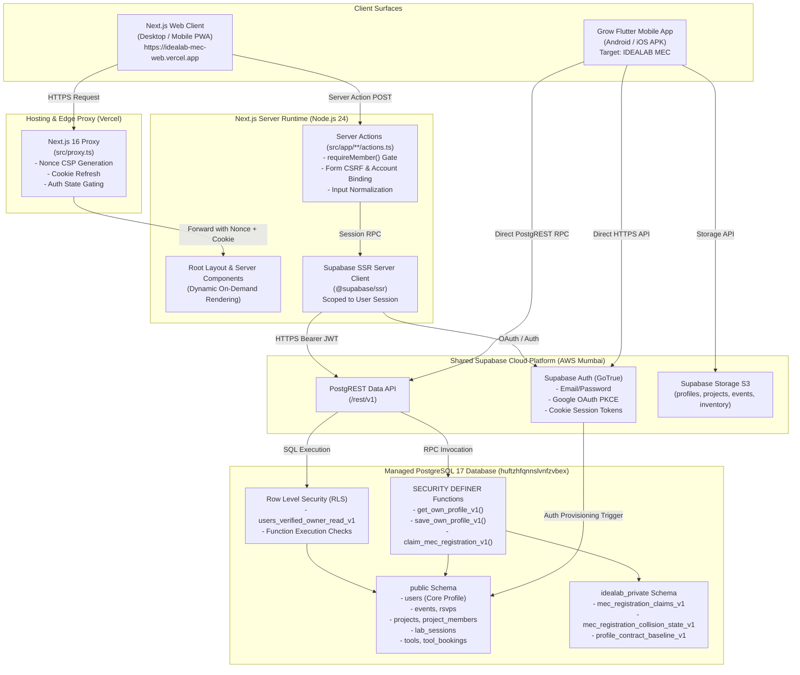

# 02 — System Architecture

**Audit Date:** 2026-11-06\\
**Auditor:** Principal Software Architect & Application Security Engineer\\
**Component:** System Architecture, Trust Boundaries & Cross-Client Data Flow

---

## 1. End-to-End System Architecture



---

## 2. Web Architecture & Request Lifecycle

### 2.1 The Next.js 16 Proxy (`src/proxy.ts`)
Next.js 16 deprecated `middleware.ts` in favor of `proxy.ts`. The implementation in `src/proxy.ts` executes on every unmatched page request:
1. **Dynamic CSP Nonce Generation:** Generates a 128-bit cryptographic nonce (`randomBytes(16).toString('base64')`) per request.
2. **CSP Header Attachment:** Injects strict Content-Security-Policy headers restricting script and style evaluation.
3. **Session Rehydration:** Invokes `createServerClient` to refresh session cookies via `@supabase/ssr`.
4. **Route Gating:** Intercepts protected paths (`/app`, `/app/*`, `/account-access`).
   - If `backendConfig()` returns null (which occurs on hosted Vercel deployments due to source gating), it immediately issues a `307 Temporary Redirect` to `/sign-in?notice=configuration`.
   - If unauthenticated, it redirects to `/sign-in?notice=session`.
5. **Private Response Headers:** Attaches `Cache-Control: private, no-store` and `Vary: Cookie` to all authenticated and auth-related responses.

### 2.2 Server Component & Server Action Separation
- **Read Path (Server Components):** Pages under `src/app/app/` are React Server Components that call `requireMember()` in `src/lib/member.ts`. `requireMember()` loads the session, executes `get_own_profile_v1()` via Supabase RPC, and enforces `profileState === 'ready'`.
- **Write Path (Server Actions):** All user mutations (profile updates, MEC declaration, check-in, event draft creation, project creation) are implemented as asynchronous Server Actions with `'use server'`.
- **Account Binding:** Every form submission includes `expected_account` which is validated against the authenticated user's ID via `matchesFormAccount(form, user.id)` to prevent cross-account form replay or tab hijacking.

---

## 3. Trust Boundaries & Security Enclaves

```text
[ UNTRUSTED ]
  │  Web Browser / Mobile Client (Client State, Form Inputs, LocalStorage)
──┼─────────────────────────────────────────────────────────────────────────────
[ BOUNDARY 1: Next.js Server / Edge Runtime ]
  │  - CSP Nonce Enforcement
  │  - HttpOnly Cookie Validation (SameSite=Lax, Secure)
  │  - matchesFormAccount() Verification
  │  - Input Sanitization & Regex Bounding (auth-input, visit-command)
  │  - No Server-Side Secrets / Service Role Bypass
──┼─────────────────────────────────────────────────────────────────────────────
[ BOUNDARY 2: PostgREST & Supabase Auth API ]
  │  - JWT Signature & Expiry Verification
  │  - anon vs authenticated Role Assignment
──┼─────────────────────────────────────────────────────────────────────────────
[ BOUNDARY 3: PostgreSQL Database Engine ]
  │  - Row-Level Security (RLS) Policies
  │  - idealab_private Schema Isolation (No Public/Anon/Authenticated USAGE)
  │  - Explicit Column-Level SELECT Grants (12 fields on public.users)
  │  - SECURITY DEFINER Functions with search_path = ''
  │  - Transaction Locks (FOR UPDATE, Access Exclusive on cutovers)
```

### Critical Security Assertions:
1. **Zero Client Trust:** Neither client role, position, email confirmation status, nor admission claims sent from the browser/app are trusted. All authorization is derived from `auth.uid()` and verified table rows inside PostgreSQL transactions.
2. **No Service-Role Key on Web:** The web application configuration strictly rejects service-role keys (`sb_secret_*` or JWT with `role !== 'anon'`) in `src/lib/config.ts`. All operations execute within the authenticated user's database role.
3. **Private Schema Quarantine:** Institutional and security-critical tables (`mec_registration_claims_v1`, `staff_scopes_v1`, `lab_opening_state_v1`, `recovery_authorities_v1`) live in `idealab_private`. This schema has its default permissions revoked and cannot be queried directly over PostgREST `/rest/v1`.

---

## 4. Shared Backend & Grow Flutter Integration Boundary

The IDEALAB platform utilizes a single shared Supabase instance (`huftzhfqnnslvnfzvbex`).

### 4.1 Shared Database Architecture
Both the Next.js website and the Flutter Grow mobile app target the same PostgreSQL database:
- **Shared Identity:** `auth.users` handles identity provisioning for both web and mobile.
- **Shared Core Profile:** `public.users` stores the primary user identity.
- **Legacy Grow Ecosystem:** Tables created by Grow (`clubs`, `tools`, `tool_bookings`, `lab_sessions`, `events`, `rsvps`, `projects`, `project_members`, `user_profiles`, `user_experience`, etc.) exist in `public`.

### 4.2 Cross-Client Breaking Discrepancy
The installation of migration `20261102130200_shared_profile_contract_v1` on 2 November 2026 hardened `public.users`:
1. It dropped `users_read_all`, `users_insert_own`, and `users_update_own`.
2. It revoked `INSERT` and `UPDATE` on `public.users` from `authenticated`.
3. It granted `SELECT` only on 12 explicit columns where `id = auth.uid()`.

**Consequence for Grow Mobile Client:**
- `Grow/lib/features/auth/data/auth_repository.dart` attempts direct `_client.from('users').insert(...)` and `_client.from('users').update(...)`. These operations now fail with PostgreSQL permission denied (`42501`)!
- Mobile queries that join `public.users` to show project members or booking names now return empty rows because cross-user SELECT is completely blocked.
- While Grow has an isolated `shared_account_gateway.dart`, the main mobile app flows have NOT been completely migrated to use `get_own_profile_v1()`, creating a severe cross-client compatibility break.

---

## 5. Architectural Weaknesses & Single Points of Failure

1. **Dual Migration Sources with Zero In-Repo Migrations:**
   `idealab-mec-web/supabase/migrations/` is completely empty. The migrations reside partly in `Grow/supabase/migrations/` and partly in `idealab-mec-web/supabase/validation/`. There is no unified, automated CI/CD migration pipeline linking code changes to database deployments.
2. **Environment-Coupled Source Gates:**
   Application code contains hardcoded checks against `process.env.ACCOUNT_ENVIRONMENT === 'validation'`. Core business logic for work requests, projects, lab opening, and events cannot execute in staging or production without manual code edits.
3. **Missing Background Processing & Queue Infrastructure:**
   There is no Redis, Celery, BullMQ, or pg_boss queue. All async operations (waitlist promotion, notifications, reminder timeouts) are either synchronously attempted inside RPC transactions or not implemented.
4. **Absence of Realtime CDC Subscriptions:**
   While Supabase Realtime exists on the platform, neither the web client nor the Server Actions utilize Supabase Realtime subscriptions to push updates (e.g., live presence, lab opening changes, queue updates). The UI relies entirely on full page revalidations and manual polling.
