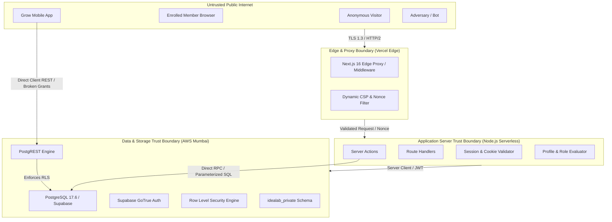

# MASTER AUDIT DELIVERABLE 08 — SECURITY THREAT MODEL

> **Audit Target:** IDEALAB MEC Platform & Shared Ecosystem (`idealab-mec-web` & `Grow`)\\
> **Methodology:** STRIDE Modeling, OWASP Top 10 (2021), OWASP ASVS v4.0.3 (Level 2 Baseline)\\
> **Status:** DRAFT — Corrections applied after owner review 2026-11-06\\
> **Classification:** SOURCE-BASED THREAT MODEL (Runtime evidence not yet attached)\\

> [!CAUTION]
> This threat model is based on source analysis and read-only database telemetry. Threat scenarios marked "(candidate)" exist only in uninstalled SQL candidates, not in shared production. No threat has been confirmed as exploitable without runtime evidence. TH-D-02 has been reclassified — see section 3.5.\\

---

## 1. Threat Modeling Scope & Trust Boundaries

The IDEALAB MEC platform mediates both digital maker collaboration and physical access to dangerous industrial prototyping equipment (Class 4 laser cutters, 3-axis CNC mills, high-temperature 3D printers). Security compromises directly translate to physical safety hazards, institutional privacy violations, or operational downtime.

### 1.1 Architecture & Trust Boundary Diagram

### 1.2 Assets at Risk

1. **Physical Safety & Machine Infrastructure:** CNC routers, Epilog laser cutters, resin 3D printers. Unauthorized activation or untrained operation creates fire and severe physical injury hazards.
2. **Private Institutional Student Data:** The 6 private MEC fields (`name`, `phone`, `college_roll`, `department`, `study_year`, `institution`), and student presence patterns.
3. **Intellectual Property:** Member project designs, patent documentation drafts, schematic CAD files uploaded to work requests.
4. **Institutional Integrity & Audit Trail:** Lab opening/closing timestamps, attendance records, machine safety sign-offs, and administrative rosters.
5. **Shared Production Database:** Supabase instance `huftzhfqnnslvnfzvbex` shared with the Grow Flutter application.

---

## 2. Threat Actor Characterization

| Actor Profile | Description | Capabilities | Primary Motivations |
| :--- | :--- | :--- | :--- |
| **A1: Anonymous Web Scraper / Bot** | Automated crawler on the public internet. | Crawls public routes, attempts credential stuffing, monitors exposed endpoints. | Data harvesting, discovering exposed API keys, scraping student directories. |
| **A2: Unadmitted Student / Squatter** | Enrolled college student or outsider without valid MEC admission. | Authenticated with Google/Email, attempts to claim roll numbers belonging to others. | Gaining free access to expensive lab machines, squatting on legitimate students' roll numbers. |
| **A3: Malicious Member** | Valid, admitted student member. | Uses browser developer tools, manipulates local storage, crafts direct PostgREST calls. | Fabricating lab presence hours, bypassing waitlists, viewing others' work requests, accessing machine queues. |
| **A4: Disgruntled / Rogue Staff** | Core lab staff or Machine Head with revoked status. | Possesses historical knowledge of system, may hold stale API sessions. | Unaudited lab operations, overriding head assignments, tampering with attendance logs. |
| **A5: Infrastructure / Supply Chain** | Compromised npm dependency or third-party cloud service. | Injected code running in client browser or Node.js server. | Stealing session tokens, exfiltrating database credentials, intercepting private user data. |

---

## 3. STRIDE Threat Analysis Across Tiers

### 3.1 Spoofing (S)

- **TH-S-01: College Roll Number Preemption (Squatting):**
  - *Threat:* An attacker with a verified email registers and claims an unverified victim's MEC roll number (`college_roll`) before the legitimate student onboards.
  - *Current Mitigation:* `idealab_private.claim_mec_registration_v1` requires strict uppercase normalization and unique reservation in `mec_registration_claims_v1`. However, there is no manual institutional roster verification step.
  - *Residual Risk:* **High.** If the real owner later registers, they are hard-blocked with collision notice until administrative intervention.
- **TH-S-02: OAuth Callback State Tampering:**
  - *Threat:* Manipulating the OAuth callback redirect URI to steal PKCE auth codes.
  - *Mitigation:* `src/app/auth/callback/route.ts` hardcodes origin checks to deployment configuration (`new URL(config.callback).origin`), completely ignoring forwarded host headers.
  - *Residual Risk:* **Low.**

### 3.2 Tampering (T)

- **TH-T-01: Client-Side Draft Manipulation in Browser Storage:**
  - *Threat:* Modifying IndexedDB or localStorage work request drafts or journal entries to submit unauthorized fields.
  - *Mitigation:* The server-side intake handler (`submit_work_request_v1`) re-validates all fields independently and ignores client-supplied user IDs or timestamps.
  - *Residual Risk:* **Low.**
- **TH-T-02: Concurrency Race Condition on Profile Updates:**
  - *Threat:* Simultaneous updates from mobile and web corrupting member profile state.
  - *Mitigation:* `save_own_profile_v1` uses optimistic concurrency tokens (`p_expected_revision`) and row-level locks (`SELECT ... FOR UPDATE`).
  - *Residual Risk:* **Low.**

### 3.3 Repudiation (R)

- **TH-R-01: Unaudited Lab Opening and Closure Transitions:**
  - *Threat:* Staff opens or closes the lab without a persistent record of who authorized the transition.
  - *Mitigation in Candidate:* `idealab_private.mec_lab_opening_candidate.sql` records `actor_id`, `opened_at`, and `closed_at` immutably.
  - *Production Flaw:* This candidate is **not installed** in live production. Lab status in production is completely unpersisted.
  - *Residual Risk:* **Critical.**
- **TH-R-02: Revocation of Machine Head Assignments Without Reason:**
  - *Threat:* An administrator revokes a Machine Head maliciously without logging why.
  - *Mitigation in Candidate:* `staff_scope_assignments_v1` requires `revocation_reason` (min 1 char, max 500 chars) and `revoked_by` UUID.
  - *Production Flaw:* Not installed in live production.
  - *Residual Risk:* **High.**

### 3.4 Information Disclosure (I)

- **TH-I-01: Public Exposure of the 6 Private MEC Fields:**
  - *Threat:* Direct table query on `public.users` via PostgREST reveals legal names, phone numbers, and roll numbers to all authenticated users.
  - *Audit Finding:* Shared migration `20261102130200_shared_profile_contract_v1` revoked table SELECT on `public.users` and introduced `get_own_profile_v1()`. However, legacy Grow RLS policies still allow authenticated users to read profiles under certain paths.
  - *Residual Risk:* **High.**
- **TH-I-02: Member Name Visibility in Lab Presence List:**
  - *Context:* The candidate query (`mec_lab_presence_candidate.sql`) selects `u.name`.
  - *Policy Status:* Signed-in members seeing member names is an approved design decision, subject to final MEC privacy policy notice approval. Public visitors see counts only. This is an approval dependency rather than an unmitigated information disclosure vulnerability.
  - *Residual Risk:* **Low / Policy Dependency.**
- **TH-I-03: Security Advisor Warnings in Supabase:**
  - *Telemetric Finding:* Supabase Security Advisors report:
    - `get_own_profile_v1` and `get_user_role` callable by `authenticated`.
    - 3 tables in `idealab_private` have RLS enabled but NO policies defined, generating administrative warning alerts.
    - Extension `btree_gist` installed in `public` schema instead of `extensions`.
  - *Residual Risk:* **Medium / Advisory Review.**

### 3.5 Denial of Service (D)

- **TH-D-01: Foreign Key Concurrency Contention:**
  - *Telemetric Finding:* The 18 November read-only advisor reported 8 unindexed-FK findings; a stricter catalog check found 9 coverage gaps, including `tool_bookings(tool_id)` with only partial indexes. See the [captured telemetry](../../research/shared-fk-telemetry-2026-11-18.json).
  - *Assessment:* This is a performance concern. No load test or production observation established lock contention, pool exhaustion, or user-visible impact.
  - *Action:* A dedicated candidate and rollback passed a synthetic disposable PostgreSQL rehearsal. Independent SQL/security review and a broader schema rehearsal remain open; the candidate is not installed. The validation candidate `20261023081307_validation_fk_indexes_v1.sql` targets validation-only tables.
  - *Residual Risk:* **Unmeasured performance concern.**
- **TH-D-02: Hosted Backend Activation (Intentional Release Gate — Reclassified):**
  - *Context:* `src/lib/config.ts` restricts hosted backend initialization pending acceptance.
  - *Clarification:* This is an intentional release gate, not an attacker-induced denial of service. The 307 redirect on hosted `/app` is expected pre-activation behavior.
  - *Residual Risk:* **Informational / Release Gate.**

### 3.6 Elevation of Privilege (E)

- **TH-E-01: Direct Table Mutation to Escalate to `lab_admin`:**
  - *Threat:* A malicious student crafts an HTTP PATCH to `/rest/v1/users` setting `role = 'lab_admin'`.
  - *Audit Finding:* Fully mitigated by `20261102130200_shared_profile_contract_v1`, which revoked `UPDATE` privileges on `public.users` from `authenticated`.
  - *Residual Risk:* **Low.**
- **TH-E-02: Self-Appointment to Operational Positions (Machine Head):**
  - *Threat:* A student creates a record in `staff_scope_assignments_v1` making themselves Machine Head of the Epilog Laser Cutter.
  - *Candidate Mitigation:* Scopes table resides in `idealab_private`, accessible only through security definer RPCs that require `super_admin` or `student_ambassador` authority.
  - *Residual Risk:* **Low (Once installed).**

---

## 4. Prioritized Threat Matrix & Action Plan

| Threat ID | Category | Severity | Preconditions | Recommended Mitigation Action |
| :--- | :--- | :--- | :--- | :--- |
| **TH-R-01** | Repudiation | **Candidate Gap** | Staff opening/closing lab | Review, rehearse, and install `mec_lab_opening_candidate.sql` under approved operational deployment. |
| **TH-I-01** | Information Disclosure | **Advisory Review** | Authenticated PostgREST client | Audit all RLS policies on `public.users` against approved column allowlist. |
| **TH-I-02** | Policy Review | **Approval Dependency** | Signed-in user viewing presence | Finalize MEC privacy policy approval for member name display. |
| **TH-D-01** | Performance | **Unmeasured** | Concurrent usage with uncovered FKs | Independently review the 18 November telemetry/candidate, reconcile schema provenance, and rehearse on a full disposable schema before separate approval. |
| **TH-S-01** | Identity Attestation | **Policy Review** | Student signup | Determine institutional policy on `@mec.ac.in` domain requirement vs self-declaration. |
| **TH-D-02** | Release Gate | **Informational** | Hosted pre-activation | Complete cross-client acceptance tests before opening hosted gate. |
