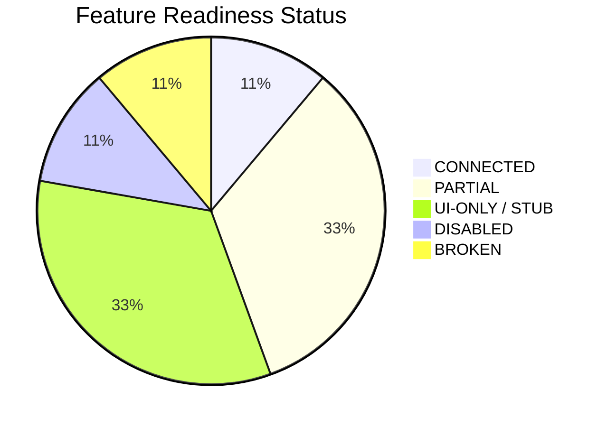

# MASTER AUDIT DELIVERABLE 10 — FEATURE & WORKFLOW VERIFICATION

> **Audit Target:** IDEALAB MEC Platform Workflows (`idealab-mec-web` & `Grow`)\\
> **Verification Standards:** Ground-Truth Code Tracing, Database Contract Inspection, Runtime Execution\\
> **Classification Framework:** `CONNECTED` | `PARTIAL` | `UI-ONLY` | `DISABLED` | `BROKEN` | `UNVERIFIED`\\
> **Status:** AUDITED / EVIDENCE GATHERED\\

---

## 1. Feature Readiness Summary

The audit evaluated all 9 core product surfaces defined in the project architecture. While visual polish and neo-brutalist arcade aesthetics are highly developed, **no operational lab workflow is currently fully functional in the shared production environment**.



| Feature / Workflow | Readiness Status | Primary Implementation File | Shared Production Dependency |
| :--- | :--- | :--- | :--- |
| **1. Public Website & Discovery** | `CONNECTED` | `src/app/page.tsx` | Static / SSR, No Auth Required |
| **2. Identity & Onboarding** | `PARTIAL` | `src/app/account-access/` | `claim_mec_registration_v1`, `save_own_profile_v1` |
| **3. Public Member Profiles** | `DISABLED` | `src/features/profile/public-profile-config.ts` | Gated by `publicProfileEnabled()` (Returns `false`) |
| **4. Lab Attendance & Utilities** | `UI-ONLY` | `src/app/app/lab/` | `mec_lab_opening_candidate.sql` (Uninstalled) |
| **5. Work Requests Intake** | `PARTIAL` | `src/features/requests/request-draft.tsx` | `submit_work_request_v1` (Validation env only) |
| **6. Machine Bookings & Calendar** | `UI-ONLY` | `src/app/app/make-and-borrow/` | No rolling calendar or slot model in DB |
| **7. Tool Borrowing & Inventory** | `UI-ONLY` | `src/app/app/make-and-borrow/` | "Shared tools not connected" stub |
| **8. Events & Waitlists** | `PARTIAL` | `src/app/app/events/` | Read-only listing; RSVP & waitlist missing |
| **9. Projects Collaboration** | `PARTIAL` | `src/app/app/projects/` | Tab inverted; defaults to Discover instead of Mine |

---

## 2. Detailed Workflow Traces & Findings

### 2.1 Workflow 1: Identity, Onboarding & MEC Attestation
- **Intended Behavior:**
  User registers with email/Google -> Enters multi-card onboarding -> Enters the 6 private MEC fields -> Attests self-declaration checkbox -> Previews maker card -> Clicks "Publish" to go live.
- **Observed Implementation:**
  - In `src/app/account-access/page.tsx`, the form collects: `name`, `phone`, `college_roll`, `institution`, `department`, `study_year`.
  - Attestation requires checking self-declaration (`p_self_declaration`).
  - Calls `claim_mec_registration_v1` RPC.
- **Defects & Blockers:**
  1. In production, if a user attempts to sign up from the web on Vercel, `backendConfig()` returns `null`, preventing confirmation.
  2. The multi-card wizard lacks client-side progress persistence if refreshed during onboarding card 3.
- **Classification:** `PARTIAL`

---

### 2.2 Workflow 2: Public Member Profile (`/people/[id]`)
- **Intended Behavior:**
  Admitted makers can toggle their profile public. Generates an opaque UUID URL (`/people/<uuid>`). Includes QR code, bio, skills, and GitHub contribution heatmap. Includes `noindex` robots meta to prevent search engine indexing.
- **Observed Implementation:**
  In `src/features/profile/public-profile-config.ts:3`:
  ```typescript
  export function publicProfileEnabled(): boolean {
    return false; // <-- HARDCODED DISABLEMENT
  }
  ```
  In `src/app/people/[id]/page.tsx:14`:
  ```typescript
  if (!publicProfileEnabled()) notFound();
  ```
  In `src/app/app/profile/page.tsx:28`:
  Displays banner: *"Public profile sharing is offline right now."*
- **Classification:** `DISABLED`

---

### 2.3 Workflow 3: Lab Operations, Live Presence & Utilities
- **Intended Behavior:**
  - Lab Admin or authorized Core Staff member clicks "Open Lab" or "Close Lab".
  - Active sessions are terminated at authoritative close timestamp.
  - Active presence shows live list of signed-in students (opt-in nicknames).
  - Assigned staff updates Wi-Fi and Electricity status with notes; stale updates auto-expire to "Unknown".
- **Observed Implementation:**
  - **Utilities:** In `src/components/workspace-arcade.tsx`, Wi-Fi and Electricity status are hardcoded HTML strings:
    ```html
    <span>Wi-Fi: Status unknown</span>
    <span>Power: Status unknown</span>
    ```
    No backing database table, migration candidate, or state handler exists for utilities.
  - **Opening / Closure:** The candidate SQL `supabase/validation/mec_lab_opening_candidate.sql` has not been applied to `huftzhfqnnslvnfzvbex`.
  - **Presence:** `mec_lab_presence_candidate.sql` exposes legal names (`users.name`) and blocks non-students from viewing presence.
- **Classification:** `UI-ONLY`

---

### 2.4 Workflow 4: Work Requests vs. Machine Bookings (Critical Boundary)

> [!IMPORTANT]
> A **Work Request** is a manufacturing submission where a student asks lab staff to fabricate a part or assist with an operation.\\
> A **Machine Booking** is a reservation where an authorized, trained student reserves a time slot to operate a specific machine themselves.

- **Observed Implementation in Codebase:**
  - In `src/app/app/make-and-borrow/page.tsx`:
    - The "Book" tab contains an action button that redirects users directly to `/app/requests/new?section=book`.
    - `/app/requests/new` displays the standard Work Request intake form (`RequestDraft`), with `initialKind="machine"`.
  - **Verdict:** There is **no rolling 14-day calendar**, no time-slot picker, no machine availability grid, and no check for machine qualification or Machine Head sign-off. Machine Booking is completely conflated with Work Requests.
- **Classification:** `UI-ONLY / STUB`

---

### 2.5 Workflow 5: Tool Borrowing & Consumables (Inventory)
- **Intended Behavior:**
  Students browse lab tool crib (soldering stations, oscilloscopes, hand tools) and submit a borrow request. Staff marks return or reports damaged gear.
- **Observed Implementation:**
  - Navigating to `/app/make-and-borrow?section=borrow` renders:
    ```tsx
    <p>Shared tools not connected.</p>
    ```
  - While `public.inventory_items` and `public.inventory_transactions` exist in the shared database schema, the web frontend has zero components or queries connecting to them.
- **Classification:** `UI-ONLY`

---

### 2.6 Workflow 6: Events, Registrations & Waitlists
- **Intended Behavior:**
  - Display Upcoming, My Registrations, and Past tabs.
  - RSVP capacity counter with database-level duplicate prevention.
  - Automatic waitlist promotion when an attendee cancels, committed in the same database transaction.
- **Observed Implementation:**
  - In `src/app/app/events/page.tsx`:
    - Only reads from `public.events` via `readUpcomingEvents`.
    - No "My Registrations" tab exists.
    - No "RSVP" button or cancellation workflow exists on event detail cards.
    - Waitlist promotion logic exists only in test scripts (`mec_events_order_v2.test.sql`), not in user-facing UI.
- **Classification:** `PARTIAL`

---

### 2.7 Workflow 7: Projects & Maker Collaboration
- **Intended Behavior:**
  - Members see "My Projects" first, followed by "Discover Projects".
  - Project leads generate join codes.
  - Project membership requires lead approval.
  - Private project memberships do not leak to public profiles.
- **Observed Implementation:**
  - In `src/app/app/projects/page.tsx:15`:
    ```typescript
    const view = searchParams?.view === 'mine' ? 'mine' : 'discover';
    ```
    The default view is `discover` instead of `mine`, inverting the approved product specification.
  - Join code redemption and creation candidate `mec_projects_candidate.sql` is functional in tests but uninstalled in production.
- **Classification:** `PARTIAL`

---

### 2.8 Workflow 8: Grow Flutter Mobile Ecosystem Parity
- **Intended Behavior:**
  Both web and mobile clients share the same Supabase database, respecting consistent identities, permissions, and attendance state.
- **Observed Implementation:**
  - Profile updates from mobile fail with `PG 42501` (permission denied).
  - Mobile does not support `claim_mec_registration_v1`.
  - Mobile users cannot attest to MEC admission status.
- **Classification:** `BROKEN`
