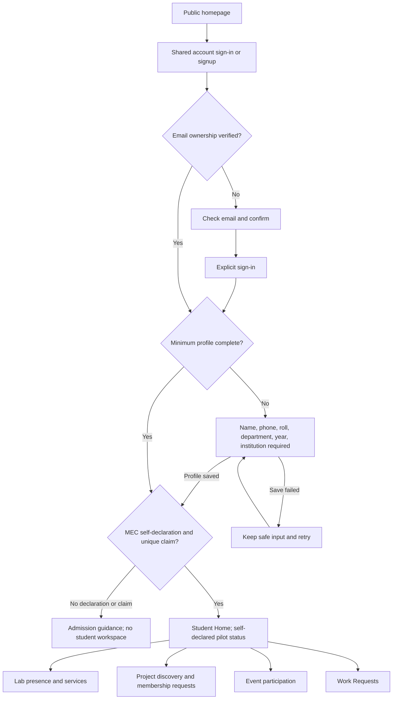
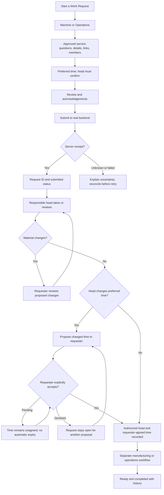
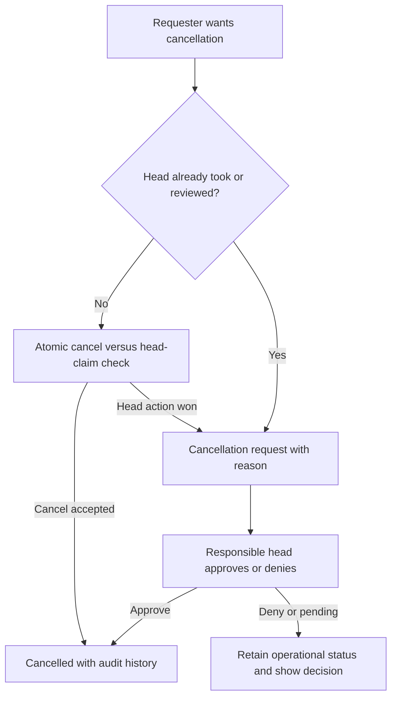

# IDEALAB MEC experience plan

Current implementation and acceptance: see [account status](account-readiness.md).
Local isolated Google login, profile/admission, core opening, own visits and
Projects are connected. Production activation remains gated. Historical
foundation checkpoints below are evidence for those revisions, not current
account/service availability.

Planning baseline: 21 October 2026. Proposed routes, flows and wireframes are labeled by implementation status; a design preview is not a deployed API contract. See [requirements](requirements.md) for scope and open decisions.

The requested homepage and visual-system pass is complete for this foundation slice; this repository still does not implement every V1 member/staff workflow. `ENABLE_MEMBER_PLATFORM=false` disables shared-account activation by default even if public keys are configured; the member/staff routes below remain full-V1 design targets pending backend acceptance.

The homepage places a tilted black/yellow moving highlights band just below the
public header and a quieter grey activity/facility ticker near the footer. The
top band does not repeat the header logo; it separates institutional highlights
with a double-backslash mark. There are no visible pause controls. Hover and
keyboard focus pause each ticker, and reduced-motion users receive still wrapped
copy. A nonce-protected head script primes motion before paint for repeat visits,
preventing the taller static fallback from reflowing during hydration or a
return navigation. No-JavaScript visitors retain all copy in still wrapped rows.
These are editorial highlights rather than live or breaking updates.

## Homepage and theme implementation

The public homepage, dark mode and polished neo-brutalist identity requested by the owner are implemented in this foundation slice. Existing request-hub work is preserved. A single Light/Dark button follows the operating-system preference until the user chooses a mode; that choice persists across reloads and tabs, with an in-memory fallback when storage is blocked. Semantic theme colors retain 2 px borders, hard shadows, readable availability text and literal artwork plates. Theme controls retain keyboard focus and work without storage permission. Literal artwork and logos keep readable plates in both modes rather than being blindly inverted. The theme toggle meets the 48 px touch-target criterion checked in responsive browser acceptance.

Design evidence: private MagicPath project `463330845164449792` includes homepage desktop/mobile, student workspace desktop/mobile, the nine-destination V1 map, MEC onboarding desktop/mobile, and scoped staff workspace desktop/mobile frames. Local Chromium acceptance is the responsive render check. MagicPath reached its account call quota while adding an account-access frame; the sign-in/join wireframe below remains documented here and matches the implemented routes. No Figma, Penpot, Canva or generated-media artifact is established. MobileMockup was inspected but its image-only mobile-app concept workflow did not fit this website task. Firebase was not selected; no additional backend stack was introduced.

## Current visual-standard interface pass

Current owner direction uses notebook cross-grid paper and the original yellow `#ffe029`/pink `#ff3994` anchors, coordinated blue `#a8c6ff`, purple `#c4b5f5`, red `#f39488` and green `#a6d9b5`, with cobalt actions and existing apricot/cream/jet-black. See [visual standard](design-system.md). Homepage content now includes Epilog, Snapmaker and Ultimaker facility photos, three broad activity themes and AICTE/CogniCor institutional context. The 11-entry `/lab` directory is published institutional content rather than live inventory; `/explore` uses officially supported March 2022 selection history. See [content provenance](content-sources.md) for verification limits. Individual event records remain signed-in only. Original local SVG artwork and HomeMotion retain progressive enhancement and reduced-motion behavior.

The maker-spirit eyebrow, hero service-availability footnote and first-card boilerplate were removed at the owner’s request. Factual unavailable messages remain on account/service routes. Sign-in, signup and recovery use real server actions in the isolated validation configuration; the production member gate remains off. Isolated Google login and the owner’s profile/declaration journey passed. Real email/password confirmation, login and recovery delivery remain unverified. The signup screen is a functional email/password form when configured, with no contact CTA or client-side profile writes. The loading skeleton remains scoped to sign-in to preserve ordinary not-found HTTP status behavior.

MagicPath project `463330845164449792` is a planning reference, not the high-fidelity source of the implemented interface. Its new MEC onboarding and staff desktop/mobile frames match the current design previews; account access remains documented in this file because the MagicPath call quota was exhausted before that frame could be added. No Figma/Penpot/Canva or generated-media artifact is claimed.

Notebook/content validation passed (session 11250, exit 0): lint, production build and real browser coverage of five homepage widths and all three facility photos; the full 11-entry `/lab` directory at 320/768/1440 px in both themes; `/explore` history and public event-theme boundaries; prior contrast, motion, no-JavaScript, draft and guard journeys. Jet-black dark-mode validation subsequently passed in session 7536, including the body and neutral section strip. Backend availability, full V1 and deployment remain unverified.

## Information architecture

| Surface | Proposed routes | Goal |
| --- | --- | --- |
| Public, implemented | `/`, `/explore`, `/lab`, `/projects`, `/events` | Curated IDEA Lab and facility information; individual event/project records are not public. |
| Account, implemented and locally enabled in isolation | `/sign-in`, `/sign-up`, `/forgot-password`, `/reset-password`, `/auth/callback`, `/auth/confirm`, `/auth/recovery/callback` | Real server actions and callback guards. Google journey passed; positive password/email/recovery journeys remain open. Production defaults disabled. |
| Design preview, implemented | `/design/onboarding` when `ENABLE_DESIGN_PREVIEW=true` | Six required profile values plus MEC self-declaration; sample-only validation, no account access or persistence. |
| Student shell preview, implemented | `/design/student?screen=home|lab|profile|projects|events|requests|notifications|visits|borrowing|settings` when `ENABLE_DESIGN_PREVIEW=true` | Responsive student page layouts and navigation; no live account, records, submissions or role checks. |
| Member routes, locally enabled in isolation | `/app`, `/app/lab`, `/app/projects`, `/app/profile`, `/app/visits` | Protected Home/Lab/Profile, a profile edit flow under privacy review, core opening/closing, own check-in/out/history and guarded Projects. Home/Lab reuse the account's recent project projection. See scoped acceptance records. |
| Isolated intake and programme | `/app/requests`, `/app/requests/new`, `/app/requests/[id]`, `/app/events`, `/app/events/[id]` | Guarded intake submission/history/direct cancellation and programme reads. The Events route was checked in the signed-in validation browser and truthfully shows an empty programme with registration/payment disconnected. Genuine intake submit/reload/cancel remains unrun; registration and staff workflows remain incomplete. |
| Member routes, operational actions pending | `/app/notifications`, `/app/borrowing`, `/app/settings` | Honest unavailable states; no live notifications, borrowing or account-settings persistence claim. |
| Project details, implemented in isolation | `/app/projects/[id]`, `/app/projects/new`, `/app/projects/join` | Creator edits, code rotation and approval controls; genuine second-account approval/cancel/leave and concurrency acceptance remain open. |
| Staff design preview | `/design/workspace` when `ENABLE_DESIGN_PREVIEW=true` | Empty Machine/Room, Operations, Events and Super Admin layout previews; no role authority or operational action. |
| Future staff/admin | Scoped staff inbox/detail, machine/room assignment, handover and audit routes | No live staff/admin authority until permission matrix and server-side actions are implemented. |

Public desktop navigation links to curated homepage sections and sign-in; project/event record links enter the signed-in app. Public mobile navigation retains its existing bottom bar. Member navigation uses Home / Lab / Profile across desktop and phone. Lab contains Overview, Requests, Borrowing, Events, Visits and Projects; Profile contains Your details, Settings and sign out. Theme and Notifications are top-right utilities. Existing module URLs remain direct links with their parent group highlighted. Account delivery and operational availability are tracked separately in [account status](account-readiness.md).

Public links identify the current page with an underline and `aria-current="page"`.
The mobile disclosure retains native HTML behavior without JavaScript. With
enhancement, Escape closes it and restores focus to its control; Tab departure,
outside pointer and link activation close it without trapping focus. Crossing
the 800 px desktop breakpoint closes it and transfers any focused mobile control
to the current desktop link (or the first link on the homepage).

The protected member shell and no-data student preview share one top-navigation component. Context links wrap on phones without a horizontal scrolling menu. Main content follows the header in normal document flow. Home follows Grow's identity → next action → shortcuts hierarchy; Lab groups the five operational areas; Profile keeps its editors collapsed until requested. Native details controls expose profile editing and registration management. Navigation does not change authorization: every protected page retains its server member guard, and unavailable services are labeled explicitly.

The desktop/mobile student workspace layouts are drawn in the [MagicPath
wireframe](https://www.magicpath.ai/files/463330845164449792). The stable source
remains this repository and its responsive browser acceptance; the canvas is a
design handoff, not a production integration.

## Account access and join wireframes

The split-panel account pages borrow the user's reference hierarchy while
keeping the approved IDEALAB palette and current account-gate behavior. The
desktop layout keeps a brand/story panel beside one focused account panel; on
short and narrow screens the story panel leaves the viewport so the account
controls remain reachable without normal page scrolling.

```text
SIGN IN — DESKTOP
+ Back to IDEALAB MEC -------------------------------- Theme +
| Yellow maker-story panel    | Sign in to existing lab account    |
| Welcome back                | Account-service status / safe error|
| Your next idea starts here  | Email address                      |
| Short Grow account note     | Password                  Forgot?  |
|                             | [Sign in]                           |
|                             | or [Continue with Google]*          |
|                             | Help · Contact · Explore joining    |
+-----------------------------+------------------------------------+

JOIN — PHONE, 320×568
+ Back + Theme                                             +
| Create your account                                      |
| Enter an email you can verify and a password             |
| Email / create password / [Create account]               |
| Continue with Google, when its provider gate is enabled  |
| Already have an account? Sign in here                   |
+----------------------------------------------------------+
```

`/sign-up` uses the shared Auth service when its server-side validation
configuration is enabled; otherwise its form stays disabled. Email/password
signup creates an Auth identity and asks the member to confirm by email before
sign-in, and does not create a profile from unverified form data. Error copy
does not identify whether an account exists. Recovery has separate request and
password-reset pages; its callback uses a fixed origin and rejects
caller-provided destinations. Google sign-in and the completed owner onboarding
journey passed in isolation, while positive email/password confirmation and
recovery delivery remain unverified. Production activation stays gated until the
shared Grow schema/security and Flutter compatibility work is cleared.

## Account creation and onboarding

Latest pilot scope is [MEC-only on both clients](mec-pilot-admission.md).
Collect the registration number (including `MDL`/`LMDL` prefixes) and use the
canonical MEC institution value. Students self-declare current MEC attendance
and that the number was issued to them; the pilot enforces one claim per
normalized number but performs no college-record verification. Email
verification and six-field profile completion remain separate. Preserve the
trusted staff path and existing account IDs.

Follow [the onboarding requirements](onboarding-requirements.md): trusted provisioning creates an ordinary Student account, and student workspace entry requires verified email, six saved required values (**name, phone, registration number, department, current year, canonical MEC institution**) and the self-declaration plus unique registration claim. This pilot does not independently verify the student or first claimant. The public `/sign-up` route contains the actual Auth form, enabled only when server configuration permits it. Isolated Google signup, profile completion and the MEC declaration were completed; real email/password confirmation and recovery delivery remain unverified, and shared Grow production activation remains gated.

The first-time path is `homepage → sign up → email confirmation → intentional sign-in → profile check → six required values saved → MEC student self-declaration → unique claim → Home`. Existing mobile and website identities converge on the same Supabase Auth user and `public.users` row. Keep the form one-column on phones, explain the canonical institution and pilot assurance level, show required status and progress, validate beside each editable field, retain safe input across recoverable failures, and keep optional enrichment out of initial onboarding. Current decisions are Year 1–8, canonical MEC institution, one normalized MEC registration claim, country-code phone entry, self-declared MEC eligibility, and private required details. Earlier free-text multi-institution entry is historical. Username, bio, interests, skills and goals from the mobile source are deferred to later profile editing.

The current `/design/onboarding` source is an opt-in review artifact, not that account journey. It displays six required values: five editable fields and read-only “Model Engineering College.” Study year is selected from Year 1–8. Local feedback checks required values, a `+country-code` numeric phone shape, and an `MDL`/`LMDL` prefix with an alphanumeric suffix. It does not assume an exhaustive course catalog or suffix length. A separate MEC student self-declaration is required. These checks neither validate phone reachability or claim availability nor establish independent student/number verification. A linked error summary handles missing/invalid fields. Values stay in component memory; the result says nothing was sent or saved, the attestation was not checked against college records, and number availability was not checked. Planned email verification, self-edit and privacy remain distinct from working preview behavior. The current-source production-browser test is rerun for this page change; see the [MEC preview audit](ui-audit.md#mec-pilot-preview--21-october-2026) for scope and limits. The page is `noindex`, warns against entering real details, and returns 404 unless the design-preview flag is enabled.

```text
ONBOARDING — WIDE PREVIEW
+ Back to sign up ------------------------------------------ Theme +
| Six required details before member Home.                     |
+----------------------------+-----------------------------------+
| 06 profile details       | Required profile                  |
| Why these details matter  | About you: name | phone           |
| Preview-only notice        |              roll number          |
|                            | Your studies: department | study year|
|                            | MEC institution (read-only)       |
|                            | MEC self-declaration checkbox    |
|                            | [Check preview fields]             |
+----------------------------+-----------------------------------+

ONBOARDING — PHONE PREVIEW
+ Back / theme                                               +
| Heading and one-line purpose                               |
| Account context / preview-only notice                       |
+------------------------------------------------------------+
| Name → +phone → MEC number → department → Year 1–8           |
| Model Engineering College (read-only sixth value)            |
| Self-declared MEC eligibility; no roster check               |
| linked error summary if required values miss                |
| [Full-width check button]                                   |
+------------------------------------------------------------+
```

The owner confirmed case/space-insensitive comparison, +country-code entry, coordinated Flutter update and self-declared MEC eligibility for the pilot. The preview requires a separate self-declaration but does not implement database normalization, duplicate claims or enforceable save limits. Exact comparison/phone validation, claim transitions and generic duplicate responses still need the shared technical contract. Optional mobile profile fields stay outside initial onboarding and are not persisted here.

## Student workspace page map and wireframes

The opt-in `/design/student` preview makes nine student destinations reviewable
without exposing fake member data. Query values are `home`, `lab`, `profile`,
`projects`, `events`, `requests`, `notifications`, `visits` and `borrowing`. Every
view carries a no-live-data banner, its own unavailable or empty state, the shared
Light/Dark toggle and a link back to the public site. The route is `noindex` and
returns 404 unless `ENABLE_DESIGN_PREVIEW=true`; it does not sign in, query
Supabase, save form data or authorize any role.

**Desktop:** fixed left rail groups Home/Lab/Profile separately from Projects,
Events, Requests, Notifications, Visits and Borrowing. The top bar carries the
current-page breadcrumb, preview-mode label and direct theme toggle. The content column starts
with a preview-status banner, one page title and a contextual surface. Home shows
the module links and pilot/scheduling notes. Lab puts approved visit guidance next
to facility/service availability states. Profile shows the six planned private
fields and an edit-layout wireframe; a registration-number change must preserve
the unique-claim rule. Projects show discovery, a record-detail layout and the
creator-reviewed join-request path. Events show a detail layout and approved
eligibility, capacity and free/paid registration states, with manual payment
verification separated from a seat. Requests show Machine/Operations, the local
draft entry point, an empty submitted-request state and the proposed-time
acceptance lifecycle. Visits cover pre-arrival guidance, manual check-in/out and
history. Borrowing covers an approved catalog, item details, issue and return
verification. These are state/layout maps without pretend records, forms or
operational buttons.

**Responsive member layout:** Home / Lab / Profile stays at the top on every width. The brand and utilities occupy the first phone row; the three navigation links occupy the second. Lab and Profile context links wrap beneath. Cards stack on phones and use two or three columns as space permits. There is no member sidebar, fixed bottom bar or More menu.

```text
MEMBER WORKSPACE — DESKTOP / MOBILE
+------------------------------------------------------------+
| IDEALAB MEC            HOME  LAB  PROFILE      Theme  Alerts |
| [Lab: Overview Requests Borrowing Events Visits Projects]    |
| or [Profile: Your details Settings]                Sign out |
+------------------------------------------------------------+
| Home: greeting → next action → Visits / Projects / Events   |
| Lab: five module cards → facilities / lab-team links        |
| Profile: identity → expandable editors → settings           |
+------------------------------------------------------------+
```

The public website navigation remains separate. This arrangement is based on current Grow screen hierarchy, not proof of live operational data. Source and focused browser evidence are in [navigation acceptance](research/workspace-topnav-2026-10-22.json).

**Module detail-state map:** Projects: discover → signed-in detail → join request
→ creator decision. Events: review terms → free registration or paid proof →
manual payment/capacity decision. Requests: preferred time → assigned-head review
→ requester accepts a changed proposal or asks for another → agreed time and
recorded history. Visits: guidance → check-in → active visit → check-out/history.
Borrowing: approved catalog → item/request → Operations issue → member reports
return → Operations verifies. These diagrams show intended page states, not
enabled actions; production member routes remain behind the account/backend gate.

Implemented product routes remain distinct: `/app` and its subroutes are
protected and disabled by the shared-account feature flag; their live records,
actions and backend access still require the shared schema/security contract.
This preview is a UI/wireframe handoff, not production member-page completion.

## Local request-workspace slice

Current local source integrates protected `/app/requests` and opt-in `/design/requests` with one shared v1 draft parser/writer, restore-query/return-link continuity, local save timestamps, and account-keyed storage for members. Legacy v1 drafts without a `references` field restore as an empty list. Optional references accept up to five complete `http`/`https` URLs (2,048 characters each), reject embedded credentials and unsafe protocols, and open from review with `rel="noreferrer"`. Invalid/corrupt stored data is kept until the user explicitly replaces or deletes it. Validation errors appear on Continue or Save so a blur-triggered rerender cannot swallow the submit click; the invalid field receives focus after the submit event. The member route retains server identity/profile guards. The opt-in preview uses page memory only, requires `ENABLE_DESIGN_PREVIEW=true`, clears on refresh or leaving the app, and cannot establish member/staff authorization. No fictional operational inbox is introduced.

The opt-in `/design/workspace` page turns the staff wireframe into a responsive, four-scope layout preview for Machine/Room Head, Operations Head, Events Head and Super Admin. Its role selector changes explanatory navigation only; the inbox/detail panels stay explicitly empty, there are no sample counts or operational buttons, and selection writes no storage or backend data. The page is `noindex` and returns 404 unless `ENABLE_DESIGN_PREVIEW=true`; it does not authenticate a staff member or authorize a real route. On mobile the navigation and inbox stack into a single column rather than forcing a squeezed list/detail split view. The rule cards keep the confirmed request-time and assignment boundaries visible while live permissions remain disconnected.

Planned local-draft journey: request hub → prepare or continue the account’s saved draft → type/details/review → save locally → return to hub → continue or confirm deletion. Submitted requests occupy a distinct unavailable section, never a fabricated empty list. Local storage is not an account-security boundary against a user of the same browser; shared-device warnings and account-specific keys remain necessary.

Acceptance before this slice passes:

- Preserve one draft per account and restore supported legacy saved drafts without overwriting malformed data merely by reading it.
- Isolate account A/B keys and sample-preview keys; deletion affects only the selected account’s draft.
- Recover from missing, corrupt, invalid-reference and storage-denied states; retain safe current inputs and provide retry/prepare-without-saving paths.
- Verify member draft reload continuity and browser-clock metadata; verify preview memory survives only in-app navigation, clears on refresh/exit, and never reaches browser storage; confirm permanent deletion.
- Exercise keyboard/focus/Back and responsive hub/composer at the established widths; preview-disabled routes return 404 and `/app` stays protected.
- No online submission, manufactured request IDs, assigned heads, operational history, charges or reservations; no backend requests from the isolated design flow.

The local production-browser acceptance exercises valid-link review and restore across in-app navigation, unsafe-protocol rejection, focused field errors, delete confirmation/focus, memory-only preview drafts, route-exit cleanup, responsive layouts and the preview-disabled 404. It also checks the staff layout selector, empty/no-action states, no local persistence, reduced motion, jet-black dark theme and mobile-to-desktop widths. Boundary tests cover legacy-v1 normalization, malformed/out-of-bounds links, unsupported services, memory-scope isolation, storage denial, quota failure and preservation of a previously saved draft. Preview drafts clear on full refresh or leaving the preview and never write to browser storage. These checks use the isolated design preview with Supabase configuration empty; no live member/staff workflow or online submission is established.

## Journey contracts

The first diagram is the Student path. Existing staff retain their independently
trusted access path; a Student registration claim does not assign staff authority.







Project join: code/discovery → membership request → pending → creator approves/denies. Event: eligible registration → free confirmation or UPI/proof → awaiting verification → capacity-checked confirmation; unverified payment holds no seat. Event cancellation/refund request goes to Events Head. Lab: purpose → check-in → active visit → check-out. Borrowing: eligible request/issue → expected return → member marks returned → Operations verifies. A visit grants no machine authority.

Staff start with a role-specific inbox, explicit machine/room assignment and next action. Machine Head reviews/requests changes/confirms time, creates separate tasks and manages queue/runtime. A changed time remains proposed until the requester explicitly accepts; show Accept proposed time and Request another time controls with audit history. Declining keeps the request open for another proposal, with no automatic expiry. Operations handles operations requests, stock, borrowing and billing. Events Head publishes events and resolves capacity/payment/attendance/refund work. Only Super Admin assigns/revokes machine/room-specific head responsibilities and manages active-work handover/reassignment through audited server operations. Detailed action permissions, handover mechanics, automatic reassignment and in-flight transaction effects remain unresolved; the UI must not imply those rules are settled. Show only controls backed by current server permission checks.

## Wireframes

```text
PUBLIC / WIDE
+ IDEALAB MEC -- About Facilities Participation ------- Sign in -+
| MAKE IDEAS REAL.                  | Approved authentic imagery  |
| Purpose and participation         | with rights and alt text    |
| [Explore the lab] [Sign in]       |                             |
+ What you can do ----------------------------------------------+
| [Request work]       [Build projects]       [Attend events]     |
+ Curated facilities / participation; records require sign-in ---+
| How it works: sign in -> request -> head confirms -> track      |
| Contact/location/approved hours       Policies/accessibility    |
+---------------------------------------------------------------+
```

```text
MEMBER HOME / WIDE
+ IDEALAB MEC ------------------------------- Inbox -- Account --+
| Home     | Welcome, Name                  [Start a request]     |
| Lab      | [Action required: review proposed changes]           |
| Profile  +---------------------------+-------------------------+
|          | Your requests             | Lab visit               |
| Projects | Real status / next action  | Active or checked out   |
| Events   | [View all]                | [Check in / Check out]  |
| Requests +---------------------------+-------------------------+
| Workspace| Your projects             | Your upcoming events    |
+----------+---------------------------+-------------------------+
Workspace appears only for authorized responsibilities.
```

```text
REQUEST DETAIL / WIDE
+ Back to requests -------- Title / ID / current status ----------+
| Details | Activity | Links                                     |
+----------------------------------+-----------------------------+
| Next action and responsible actor | Machine / Operations        |
| Changes / proposed time to accept | Requested time              |
| [Approve] [Ask for changes]       | Head-confirmed time, if any |
| Actor / event / time history      | Members / external links    |
| Verified quote/payment, if any    | [Cancel / Request cancel]   |
+----------------------------------+-----------------------------+
```

```text
STAFF / WIDE
+ Workspace / Machine --------------- Machine / room scope -----+
| Requests | [Needs review] [Changes] [Ready] [In progress]        |
| Tasks    | Search / filters / clear                            |
| Queue    +-----------------------+-----------------------------+
| Machines | Request / age         | Selected request            |
| Reports  | Preferred time        | [Take request]              |
|          | Next action           | [Request changes]           |
|          |                       | [Confirm time]              |
|          |                       | Separate tasks / activity   |
+----------+-----------------------+-----------------------------+
```

```text
MOBILE / REQUEST
+ IDEALAB MEC -------- Inbox -- Account +
| Back             Request ID / status |
| Action required                       |
| Clear instruction                     |
| [Primary action - full width]          |
| Summary / requested time              |
| Changes / quote / activity sections    |
| [Safe cancellation action]             |
+---------------------------------------+
|       Home       Lab       Profile    |
+---------------------------------------+
Staff: list -> detail -> Back, never a squeezed split pane.
Forms: one column, named step/progress, Back / Continue.
```

## Visual and interaction acceptance

- Follow [the visual standard](design-system.md): yellow/pink anchors, coordinated blue/purple/red/green plates, cobalt actions and apricot details on cream/jet-black notebook cross-grid surfaces; Space Grotesk display and DM Sans body, shared spacing, 2 px borders and hard shadows. Use semantic tokens, authentic assets and original SVG doodles; no invented installed equipment.
- Reflow at 320, 375, 768, 1024 and 1440 CSS px. No page-level horizontal overflow. Tables need meaningful narrow-screen alternatives; split panes become list/detail. Filters collapse without losing active state.
- Use 48 px touch controls, visible keyboard focus, skip link, semantic landmarks/headings, named icon buttons and predictable focus restoration. Support browser zoom/enlarged text, sufficient contrast and reduced motion. Status never relies on color alone.
- Forms have visible labels, field-specific errors, error summary/focus, retained safe inputs and loading/duplicate-submit handling. Explicit confirmation for consequential financial/destructive actions.
- Every data surface includes loading, empty, retryable failure, offline and unauthorized states. Show unavailable where contracts are missing. Temporarily authorized sample catalog entries must display **Demo — not verified stock or prices**, remain separate from real data and support no operational bookings/payments. Never substitute demo records for real operational results or success. Unknown submission outcomes must reconcile rather than blindly duplicate.
- No unsupported privacy promises, badges, payment confirmation, check-in result, reservation, stock, prices, testimonials or queue/ETA values. Draft scope and persistence must be explicit.

The canonical website decisions are recorded in [requirements](requirements.md), these experience specifications and [architecture](architecture.md). Historical parent Grow inputs include `docs/01_Design/PENPOT_ACCEPTANCE_MATRIX.md`, `docs/01_Product/PRODUCT_DECISION_DELTA_2026-09-17.md`, `docs/02_Product/WORK_REQUEST_CONTRACT_DELTA.md` and `docs/02_Product/PROFILE_ECOSYSTEM_DECISION_GATE.md`; these provenance paths are not dependencies of the standalone repository. Wireframes remain specifications; browser and assistive-technology acceptance need their own evidence.

Current implemented foundation: curated public homepage, a two-state Light/Dark toggle with operating-system preference before a choice, disabled-by-default existing-account sign-in source, protected member routes and browser-only request workspace/composition. The implementation at `a3b0033` passed its local production-browser suite and hosted CI; later workflow code adds a manual preview-only Vercel path with member/design flags required off. On 21 October, Node 24 lint/typecheck, 23 boundary tests, dependency audit, production build, real Chromium acceptance and the documentation/link check passed; exact-head hosted Website CI, required gate and Documentation CI also passed. Full V1, live auth/onboarding/backend journeys, independent PR review and deployment remain gated.

## Branded loading state

The first page boot uses repeated lowercase wordmarks, a drawn prototype mark, an orbiting blueprint marker and a three-beat typography reveal. It appears once per browser-tab visit. Font/high-priority image readiness is bounded by 1.1 seconds; fast loads hold the completed scene for at least 1.22 seconds before a 320 ms exit. The slower indeterminate rail sweep avoids implying measured progress. Page controls remain inert through the hand-off. Reduced-motion users skip the animation; the hydrated watchdog and inline no-hydration fallback release page interaction if startup stalls. JavaScript-disabled browsers do not receive an overlay. The root route has no loading boundary, preserving ordinary 404 HTTP responses. Current browser acceptance and timing evidence are in [the loader record](quality/loader-motion-2026-10-31.md); this animation does not imply live backend readiness.


## Account-state route — 22 October 2026

The protected `/account-access` page sits outside the operational workspace.
Unverified accounts see confirmation guidance, inactive accounts see their
restriction, incomplete profiles see setup status, complete non-admitted Students
see the MEC declaration/claim requirement, and unavailable/malformed responses
receive retry guidance. Ready accounts redirect to `/app`. This prevents protected
children from fetching account data merely because a layout displays a status.
The real account page now provides the four-step profile wizard and separate
declaration/claim form, while confirmation has its own resend action. Genuine
Google login and profile provisioning passed in isolation. Real personal-profile,
admission and email/password/recovery acceptance remain open; see [account
delivery status](account-readiness.md). The design preview remains separate and
cannot complete a real account.
