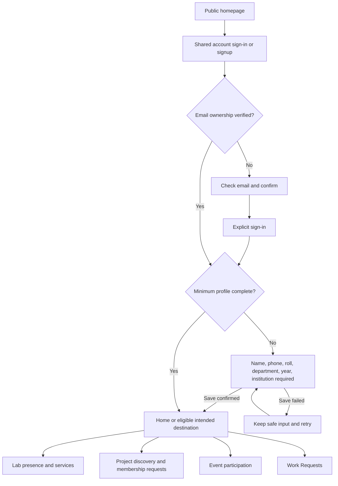
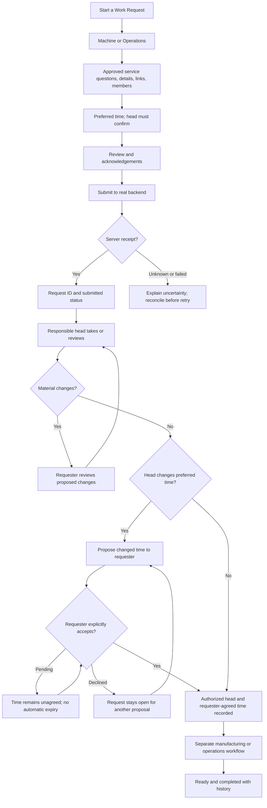
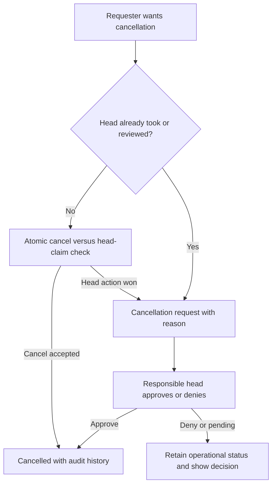

# IDEALAB MEC experience plan

Current UI/auth verification: see [UI audit](ui-audit.md). It supersedes earlier notes about three-option theme menus, repeated boot loading and database timeouts. Supabase read-only connectivity is restored; shared authorization/profile-provisioning defects still block account activation.

Planning baseline: 21 October 2026. Routes, flows and wireframes below are proposed specifications, not claims of implemented screens or deployed API contracts. See [requirements](requirements.md) for scope and open decisions.

The requested homepage and visual-system pass is complete for this foundation slice; this repository still does not implement every V1 member/staff workflow. `ENABLE_MEMBER_PLATFORM=false` disables shared-account activation by default even if public keys are configured; the member/staff routes below remain full-V1 design targets pending backend acceptance.

## Homepage and theme implementation

The public homepage, dark mode and polished neo-brutalist identity requested by the owner are implemented in this foundation slice. Existing request-hub work is preserved. A single Light/Dark button follows the operating-system preference until the user chooses a mode; that choice persists across reloads and tabs, with an in-memory fallback when storage is blocked. Semantic theme colors retain 2 px borders, hard shadows, readable availability text and literal artwork plates. Theme controls retain keyboard focus and work without storage permission. Literal artwork and logos keep readable plates in both modes rather than being blindly inverted. The toggle uses a 44 px target; the wider 48 px touch-target criterion below remains the design target.

Design evidence: private MagicPath project `463330845164449792` was created and opened; an actual canvas read verified 11 shapes across two desktop/mobile frames. No Figma, Penpot, Canva or generated-media artifact is established. MobileMockup was inspected but its image-only mobile-app concept workflow did not fit this website task. Firebase was not selected; no additional backend stack was introduced.

## Current visual-standard interface pass

Current owner direction uses notebook cross-grid paper and the original yellow `#ffe029`/pink `#ff3994` anchors, coordinated blue `#a8c6ff`, purple `#c4b5f5`, red `#f39488` and green `#a6d9b5`, with cobalt actions and existing apricot/cream/jet-black. See [visual standard](design-system.md). Homepage content now includes Epilog, Snapmaker and Ultimaker facility photos, three broad activity themes and AICTE/CogniCor institutional context. The 11-entry `/lab` directory is published institutional content rather than live inventory; `/explore` uses officially supported March 2022 selection history. See [content provenance](content-sources.md) for verification limits. Individual event records remain signed-in only. Original local SVG artwork and HomeMotion retain progressive enhancement and reduced-motion behavior.

The maker-spirit eyebrow, hero service-availability footnote and first-card boilerplate were removed at the owner’s request. Factual unavailable messages remain on account/service routes. Sign-in retains its semantic form and password show/hide control, disabled while account activation is unavailable. The auth story panels use the current shared palette and theme controls. `/sign-up` remains information/contact only, with no registration writes or OAuth. The loading skeleton remains scoped to sign-in to preserve ordinary not-found HTTP status behavior.

MagicPath project `463330845164449792` was updated with hierarchy/wireframe annotations and earlier accent panels. It is a planning reference, not the high-fidelity source of the implemented interface. No Figma/Penpot/Canva or generated-media artifact is claimed.

Notebook/content validation passed (session 11250, exit 0): lint, production build and real browser coverage of five homepage widths and all three facility photos; the full 11-entry `/lab` directory at 320/768/1440 px in both themes; `/explore` history and public event-theme boundaries; prior contrast, motion, no-JavaScript, draft and guard journeys. Jet-black dark-mode validation subsequently passed in session 7536, including the body and neutral section strip. Backend availability, full V1 and deployment remain unverified.

## Information architecture

| Surface | Proposed routes | Goal |
| --- | --- | --- |
| Public | `/`, `/about`, `/facilities`, `/contact`, `/policies/[slug]` | Understand the lab and participation; enter shared account flow. |
| Curated public sections | Homepage editorial facilities/participation sections | Individual project/event records are signed-in only; no anonymous record routes. |
| Account | `/sign-in`, `/sign-up`, `/auth/confirm`, `/forgot-password`, `/reset-password`, `/onboarding` | Verified identity, explicit sign-in and minimum profile. |
| Design preview | `/design/onboarding` when `ENABLE_DESIGN_PREVIEW=true` | Review the six required identity fields and validation; sample-only, no account access or persistence. |
| Member | `/app`, `/app/lab`, `/app/lab/check-in`, `/app/lab/history`, `/app/lab/catalog` | Home, presence/history and verified services. |
| Requests | `/app/requests`, `/app/requests/new`, `/app/requests/[id]` | Compose, review, track and resolve requests. |
| Projects | `/app/projects`, `/app/projects/new`, `/app/projects/[id]`, `/app/projects/[id]/members` | Discovery, ownership and membership requests. |
| Events | `/app/events`, `/app/events/[id]`, `/app/events/[id]/registration` | Eligible participation and payment/attendance status. |
| Personal | `/app/borrowing`, `/app/borrowing/[id]`, `/app/notifications`, `/app/profile`, `/app/profile/edit`, `/app/settings` | Borrowing, inbox and private account management. |
| Staff | `/app/workspace`, plus `/requests/[id]`, `/manufacturing`, `/queue`, `/machines`, `/inventory`, `/borrowing`, `/visitors`, `/payments`, `/events`, `/reports` below that prefix | Scoped operational work and accountable decisions. |
| Admin | `/app/admin`, `/app/admin/members`, `/app/admin/assignments`, `/app/admin/master-data`, `/app/admin/audit` | Trusted administration and audit. |

Public desktop navigation links to curated homepage sections and sign-in; project/event record links enter the signed-in app. Mobile uses a labeled disclosure menu. Online account creation remains planned; `/sign-up` provides honest joining information and a working contact path without implying registration success. Signed-in desktop anchors are Home / Lab / Profile; contextual Projects / Events / Requests and permissioned Workspace follow. Mobile retains three bottom anchors; modules are reached from Home/Lab. Staff section navigation uses a compact menu, breadcrumb and explicit machine/room scope.

## Account creation and onboarding

Follow [the onboarding requirements](onboarding-requirements.md): any verified-email student account starts as Student, and the member app remains gated until **name, phone, roll number, department, year, and college/institution** are saved successfully. The public `/sign-up` page is currently informational; functional account creation, email confirmation, onboarding persistence and Google acceptance remain gated by the shared-backend review.

The first-time path is `homepage → sign up → email confirmation → intentional sign-in → profile check → six required fields saved → Home`. Existing mobile and website identities must converge on the same Supabase Auth user and `public.users` row. Keep the form one-column on phones, explain why institution details are requested, show required status and progress, validate beside each field, retain safe input across recoverable failures, and keep optional profile enrichment out of initial onboarding. The owner chose Year 1–8, free-text institution, institution-scoped roll-number uniqueness, student self-edit, and private-by-default required details. Username, bio, interests, skills and goals from the mobile source are deferred to later profile editing.

The current `/design/onboarding` route is an opt-in review artifact, not that account journey. It renders six required fields and focuses a linked error summary when fields are missing. Current study year is selected from Year 1–8, and roll-number uniqueness is described as institution-scoped. The preview keeps values in component memory only and reports that nothing was sent or saved. Copy distinguishes planned email verification, self-edit and privacy defaults from currently working behavior. The page is `noindex`, warns against entering real details, and returns 404 unless the design-preview flag is enabled.

```text
ONBOARDING — WIDE PREVIEW
+ Back to sign up ------------------------------------------ Theme +
| Six required details before member Home.                     |
+----------------------------+-----------------------------------+
| 06 required details       | Required profile                  |
| Why these details matter  | About you: name | phone           |
| Preview-only notice        |              roll number          |
|                            | Your studies: department | study year|
|                            |              college/institution   |
|                            | [Check preview fields]             |
+----------------------------+-----------------------------------+

ONBOARDING — PHONE PREVIEW
+ Back / theme                                               +
| Heading and one-line purpose                               |
| Account context / preview-only notice                       |
+------------------------------------------------------------+
| Name → phone → roll → department → Year 1–8 → institution  |
| linked error summary if required values miss                |
| [Full-width check button]                                   |
+------------------------------------------------------------+
```

The owner confirmed current year of study (Year 1–8), a free-text institution value, institution-scoped roll-number uniqueness, self-edit of required fields, and private-by-default visibility. The preview explains that institutional entry does not imply email-domain verification. The cross-app database mapping and roll normalization rules remain subject to review. Optional mobile profile fields stay outside the initial onboarding and are not persisted by this preview.

## Local request-workspace slice

Current local source integrates protected `/app/requests` and opt-in `/design/requests` with basic composer restore-query/return-link and local storage. Enhanced reference validation is not implemented. The member route retains server identity/profile guards. The preview uses separate sample storage, requires `ENABLE_DESIGN_PREVIEW=true`, and cannot establish member/staff authorization. No fictional operational inbox is introduced.

Planned local-draft journey: request hub → prepare or continue the account’s saved draft → type/details/review → save locally → return to hub → continue or confirm deletion. Submitted requests occupy a distinct unavailable section, never a fabricated empty list. Local storage is not an account-security boundary against a user of the same browser; shared-device warnings and account-specific keys remain necessary.

Acceptance before this slice passes:

- Preserve one draft per account and restore supported legacy saved drafts without overwriting malformed data merely by reading it.
- Isolate account A/B keys and sample-preview keys; deletion affects only the selected account’s draft.
- Recover from missing, corrupt, invalid-reference and storage-denied states; retain safe current inputs and provide retry/prepare-without-saving paths.
- Verify reload and return-link continuity, saved metadata labelled as device-clock data, and confirmation before permanent deletion.
- Exercise keyboard/focus/Back and responsive hub/composer at the established widths; preview-disabled routes return 404 and `/app` stays protected.
- No online submission, manufactured request IDs, assigned heads, operational history, charges or reservations; no backend requests from the isolated design flow.

Basic sample journeys, corrupt-storage state and deletion-focus browser checks now pass in the local acceptance run. Extended reference-validation work remains pending; no live member/staff workflow is established.

## Journey contracts







Project join: code/discovery → membership request → pending → creator approves/denies. Event: eligible registration → free confirmation or UPI/proof → awaiting verification → capacity-checked confirmation; unverified payment holds no seat. Event cancellation/refund request goes to Events Head. Lab: purpose → check-in → active visit → check-out. Borrowing: eligible request/issue → expected return → member marks returned → Operations verifies. A visit grants no machine authority.

Staff start with a role-specific inbox, explicit machine/room assignment and next action. Machine Head reviews/requests changes/confirms time, creates separate tasks and manages queue/runtime. A changed time remains proposed until the requester explicitly accepts; show Accept proposed time and Request another time controls with audit history. Declining keeps the request open for another proposal, with no automatic expiry. Operations handles operations requests, stock, borrowing and billing. Events Head publishes events and resolves capacity/payment/attendance/refund work. Only Super Admin assigns/revokes machine/room-specific head responsibilities and manages active-work handover/reassignment through audited server operations. Detailed action permissions, handover mechanics, automatic reassignment and in-flight transaction effects remain unresolved; the UI must not imply those rules are settled. Show only controls backed by current server permission checks.

## Wireframes

```text
PUBLIC / WIDE
+ IDEALAB MEC -- About Facilities Participation ------- Sign in -+
| MAKE IDEAS REAL.                  | Approved authentic imagery  |
| Purpose and participation         | with rights and alt text    |
| [Explore the lab] [Sign in]       |                             |
+ What you can do ----------------------------------------------+
| [Request work]       [Build projects]       [Attend events]     |
+ Curated facilities / participation; records require sign-in ---+
| How it works: sign in -> request -> head confirms -> track      |
| Contact/location/approved hours       Policies/accessibility    |
+---------------------------------------------------------------+
```

```text
MEMBER HOME / WIDE
+ IDEALAB MEC ------------------------------- Inbox -- Account --+
| Home     | Welcome, Name                  [Start a request]     |
| Lab      | [Action required: review proposed changes]           |
| Profile  +---------------------------+-------------------------+
|          | Your requests             | Lab visit               |
| Projects | Real status / next action  | Active or checked out   |
| Events   | [View all]                | [Check in / Check out]  |
| Requests +---------------------------+-------------------------+
| Workspace| Your projects             | Your upcoming events    |
+----------+---------------------------+-------------------------+
Workspace appears only for authorized responsibilities.
```

```text
REQUEST DETAIL / WIDE
+ Back to requests -------- Title / ID / current status ----------+
| Details | Activity | Links                                     |
+----------------------------------+-----------------------------+
| Next action and responsible actor | Machine / Operations        |
| Changes / proposed time to accept | Requested time              |
| [Approve] [Ask for changes]       | Head-confirmed time, if any |
| Actor / event / time history      | Members / external links    |
| Verified quote/payment, if any    | [Cancel / Request cancel]   |
+----------------------------------+-----------------------------+
```

```text
STAFF / WIDE
+ Workspace / Machine --------------- Machine / room scope -----+
| Requests | [Needs review] [Changes] [Ready] [In progress]        |
| Tasks    | Search / filters / clear                            |
| Queue    +-----------------------+-----------------------------+
| Machines | Request / age         | Selected request            |
| Reports  | Preferred time        | [Take request]              |
|          | Next action           | [Request changes]           |
|          |                       | [Confirm time]              |
|          |                       | Separate tasks / activity   |
+----------+-----------------------+-----------------------------+
```

```text
MOBILE / REQUEST
+ IDEALAB MEC -------- Inbox -- Account +
| Back             Request ID / status |
| Action required                       |
| Clear instruction                     |
| [Primary action - full width]          |
| Summary / requested time              |
| Changes / quote / activity sections    |
| [Safe cancellation action]             |
+---------------------------------------+
|       Home       Lab       Profile    |
+---------------------------------------+
Staff: list -> detail -> Back, never a squeezed split pane.
Forms: one column, named step/progress, Back / Continue.
```

## Visual and interaction acceptance

- Follow [the visual standard](design-system.md): yellow/pink anchors, coordinated blue/purple/red/green plates, cobalt actions and apricot details on cream/jet-black notebook cross-grid surfaces; Space Grotesk display and DM Sans body, shared spacing, 2 px borders and hard shadows. Use semantic tokens, authentic assets and original SVG doodles; no invented installed equipment.
- Reflow at 320, 375, 768, 1024 and 1440 CSS px. No page-level horizontal overflow. Tables need meaningful narrow-screen alternatives; split panes become list/detail. Filters collapse without losing active state.
- Use 48 px touch controls, visible keyboard focus, skip link, semantic landmarks/headings, named icon buttons and predictable focus restoration. Support browser zoom/enlarged text, sufficient contrast and reduced motion. Status never relies on color alone.
- Forms have visible labels, field-specific errors, error summary/focus, retained safe inputs and loading/duplicate-submit handling. Explicit confirmation for consequential financial/destructive actions.
- Every data surface includes loading, empty, retryable failure, offline and unauthorized states. Show unavailable where contracts are missing. Temporarily authorized sample catalog entries must display **Demo — not verified stock or prices**, remain separate from real data and support no operational bookings/payments. Never substitute demo records for real operational results or success. Unknown submission outcomes must reconcile rather than blindly duplicate.
- No unsupported privacy promises, badges, payment confirmation, check-in result, reservation, stock, prices, testimonials or queue/ETA values. Draft scope and persistence must be explicit.

The canonical website decisions are recorded in [requirements](requirements.md), these experience specifications and [architecture](architecture.md). Historical parent Grow inputs include `docs/01_Design/PENPOT_ACCEPTANCE_MATRIX.md`, `docs/01_Product/PRODUCT_DECISION_DELTA_2026-09-17.md`, `docs/02_Product/WORK_REQUEST_CONTRACT_DELTA.md` and `docs/02_Product/PROFILE_ECOSYSTEM_DECISION_GATE.md`; these provenance paths are not dependencies of the standalone repository. Wireframes remain specifications; browser and assistive-technology acceptance need their own evidence.

Current implemented foundation: curated public homepage, local Light/Dark/System themes, disabled-by-default existing-account sign-in source, protected member routes and browser-only request workspace/composition. Current validation is recorded in the visual-standard interface pass above; previous homepage checks are superseded by the current-source local gate. The previous pushed revision `3ea9fd69d80b802a3ab30dd4f2f14994d02bcec9` passed both [Website CI](https://github.com/MEC-IDEALAB/IDEALAB-MEC-WEB/actions/runs/39459247881) and [Documentation CI](https://github.com/MEC-IDEALAB/IDEALAB-MEC-WEB/actions/runs/39459247807). Those hosted results do not cover the unpushed visual-standard pass. Full V1 and backend activation remain gated.

## Branded loading state

The first page boot uses a focused IDEALAB MEC maker scene over the notebook grid. It appears once per browser-tab visit, gives a fast load a 560 ms reveal, and exits once fonts/layout settle on a slower load, with a 190 ms fade. The page is made inert before its controls can receive focus; a 4.8-second fail-open watchdog removes the overlay and releases page interaction when hydration never arrives. Reduced-motion users exit immediately, and JavaScript-disabled browsers do not receive an overlay. The root route has no loading boundary, preserving ordinary 404 HTTP responses. Browser acceptance covers the early keyboard lock, both exit paths and restored keyboard access; this animation does not imply live backend readiness.
