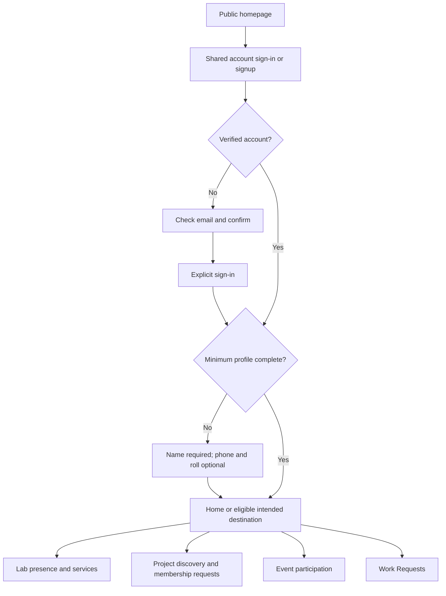
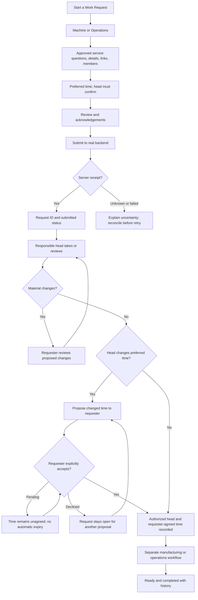
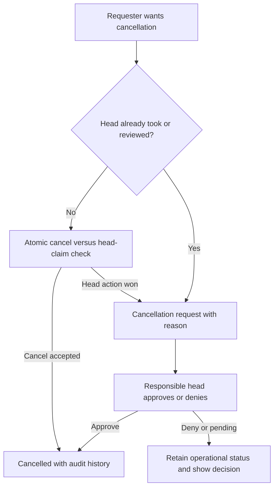

# IDEALAB MEC experience plan

Planning baseline: 20 October 2026. Routes, flows and wireframes below are proposed specifications, not claims of implemented screens or deployed API contracts. See [requirements](requirements.md) for scope and open decisions.

The owner prioritized UI and GitHub setup first. The current foundation review covers the public UI, sample preview and access-denial states. `ENABLE_MEMBER_PLATFORM=false` disables shared-account activation by default even if public keys are configured; the member/staff routes below remain full-V1 design targets pending backend acceptance.

## Information architecture

| Surface | Proposed routes | Goal |
| --- | --- | --- |
| Public | `/`, `/about`, `/facilities`, `/contact`, `/policies/[slug]` | Understand the lab and participation; enter shared account flow. |
| Curated public sections | Homepage editorial facilities/participation sections | Individual project/event records are signed-in only; no anonymous record routes. |
| Account | `/sign-in`, `/sign-up`, `/auth/confirm`, `/forgot-password`, `/reset-password`, `/onboarding` | Verified identity, explicit sign-in and minimum profile. |
| Member | `/app`, `/app/lab`, `/app/lab/check-in`, `/app/lab/history`, `/app/lab/catalog` | Home, presence/history and verified services. |
| Requests | `/app/requests`, `/app/requests/new`, `/app/requests/[id]` | Compose, review, track and resolve requests. |
| Projects | `/app/projects`, `/app/projects/new`, `/app/projects/[id]`, `/app/projects/[id]/members` | Discovery, ownership and membership requests. |
| Events | `/app/events`, `/app/events/[id]`, `/app/events/[id]/registration` | Eligible participation and payment/attendance status. |
| Personal | `/app/borrowing`, `/app/borrowing/[id]`, `/app/notifications`, `/app/profile`, `/app/profile/edit`, `/app/settings` | Borrowing, inbox and private account management. |
| Staff | `/app/workspace`, plus `/requests/[id]`, `/manufacturing`, `/queue`, `/machines`, `/inventory`, `/borrowing`, `/visitors`, `/payments`, `/events`, `/reports` below that prefix | Scoped operational work and accountable decisions. |
| Admin | `/app/admin`, `/app/admin/members`, `/app/admin/assignments`, `/app/admin/master-data`, `/app/admin/audit` | Trusted administration and audit. |

Public desktop navigation links to curated homepage sections and sign-in; project/event record links enter the signed-in app. Mobile uses a labeled disclosure menu. Account creation remains planned until its real flow is available; do not expose a dead Join control. Signed-in desktop anchors are Home / Lab / Profile; contextual Projects / Events / Requests and permissioned Workspace follow. Mobile retains three bottom anchors; modules are reached from Home/Lab. Staff section navigation uses a compact menu, breadcrumb and explicit machine/room scope.

## Journey contracts







Project join: code/discovery → membership request → pending → creator approves/denies. Event: eligible registration → free confirmation or UPI/proof → awaiting verification → capacity-checked confirmation; unverified payment holds no seat. Event cancellation/refund request goes to Events Head. Lab: purpose → check-in → active visit → check-out. Borrowing: eligible request/issue → expected return → member marks returned → Operations verifies. A visit grants no machine authority.

Staff start with a role-specific inbox, explicit machine/room assignment and next action. Machine Head reviews/requests changes/confirms time, creates separate tasks and manages queue/runtime. A changed time remains proposed until the requester explicitly accepts; show Accept proposed time and Request another time controls with audit history. Declining keeps the request open for another proposal, with no automatic expiry. Operations handles operations requests, stock, borrowing and billing. Events Head publishes events and resolves capacity/payment/attendance/refund work. Only Super Admin assigns/revokes machine/room-specific head responsibilities and manages active-work handover/reassignment through audited server operations. Detailed action permissions, handover mechanics, automatic reassignment and in-flight transaction effects remain unresolved; the UI must not imply those rules are settled. Show only controls backed by current server permission checks.

## Wireframes

```text
PUBLIC / WIDE
+ IDEALAB MEC -- About Facilities Participation ------- Sign in -+
| MAKE IDEAS REAL.                  | Approved authentic imagery  |
| Purpose and participation         | with rights and alt text    |
| [Explore the lab] [Sign in]       |                             |
+ What you can do ----------------------------------------------+
| [Request work]       [Build projects]       [Attend events]     |
+ Curated facilities / participation; records require sign-in ---+
| How it works: sign in -> request -> head confirms -> track      |
| Contact/location/approved hours       Policies/accessibility    |
+---------------------------------------------------------------+
```

```text
MEMBER HOME / WIDE
+ IDEALAB MEC ------------------------------- Inbox -- Account --+
| Home     | Welcome, Name                  [Start a request]     |
| Lab      | [Action required: review proposed changes]           |
| Profile  +---------------------------+-------------------------+
|          | Your requests             | Lab visit               |
| Projects | Real status / next action  | Active or checked out   |
| Events   | [View all]                | [Check in / Check out]  |
| Requests +---------------------------+-------------------------+
| Workspace| Your projects             | Your upcoming events    |
+----------+---------------------------+-------------------------+
Workspace appears only for authorized responsibilities.
```

```text
REQUEST DETAIL / WIDE
+ Back to requests -------- Title / ID / current status ----------+
| Details | Activity | Links                                     |
+----------------------------------+-----------------------------+
| Next action and responsible actor | Machine / Operations        |
| Changes / proposed time to accept | Requested time              |
| [Approve] [Ask for changes]       | Head-confirmed time, if any |
| Actor / event / time history      | Members / external links    |
| Verified quote/payment, if any    | [Cancel / Request cancel]   |
+----------------------------------+-----------------------------+
```

```text
STAFF / WIDE
+ Workspace / Machine --------------- Machine / room scope -----+
| Requests | [Needs review] [Changes] [Ready] [In progress]        |
| Tasks    | Search / filters / clear                            |
| Queue    +-----------------------+-----------------------------+
| Machines | Request / age         | Selected request            |
| Reports  | Preferred time        | [Take request]              |
|          | Next action           | [Request changes]           |
|          |                       | [Confirm time]              |
|          |                       | Separate tasks / activity   |
+----------+-----------------------+-----------------------------+
```

```text
MOBILE / REQUEST
+ IDEALAB MEC -------- Inbox -- Account +
| Back             Request ID / status |
| Action required                       |
| Clear instruction                     |
| [Primary action - full width]          |
| Summary / requested time              |
| Changes / quote / activity sections    |
| [Safe cancellation action]             |
+---------------------------------------+
|       Home       Lab       Profile    |
+---------------------------------------+
Staff: list -> detail -> Back, never a squeezed split pane.
Forms: one column, named step/progress, Back / Continue.
```

## Visual and interaction acceptance

- Preserve paper/ink, purposeful blue/lime/yellow/coral/pink, Space Grotesk display and DM Sans body, shared spacing, 2 px borders and restrained hard shadows. Use semantic tokens, authentic assets and original doodles; no emoji decoration or invented installed equipment.
- Reflow at 320, 375, 768, 1024 and 1440 CSS px. No page-level horizontal overflow. Tables need meaningful narrow-screen alternatives; split panes become list/detail. Filters collapse without losing active state.
- Use 48 px touch controls, visible keyboard focus, skip link, semantic landmarks/headings, named icon buttons and predictable focus restoration. Support browser zoom/enlarged text, sufficient contrast and reduced motion. Status never relies on color alone.
- Forms have visible labels, field-specific errors, error summary/focus, retained safe inputs and loading/duplicate-submit handling. Explicit confirmation for consequential financial/destructive actions.
- Every data surface includes loading, empty, retryable failure, offline and unauthorized states. Show unavailable where contracts are missing. Temporarily authorized sample catalog entries must display **Demo — not verified stock or prices**, remain separate from real data and support no operational bookings/payments. Never substitute demo records for real operational results or success. Unknown submission outcomes must reconcile rather than blindly duplicate.
- No unsupported privacy promises, badges, payment confirmation, check-in result, reservation, stock, prices, testimonials or queue/ETA values. Draft scope and persistence must be explicit.

The canonical website decisions are recorded in [requirements](requirements.md), these experience specifications and [architecture](architecture.md). Historical parent Grow inputs include `docs/01_Design/PENPOT_ACCEPTANCE_MATRIX.md`, `docs/01_Product/PRODUCT_DECISION_DELTA_2026-09-17.md`, `docs/02_Product/WORK_REQUEST_CONTRACT_DELTA.md` and `docs/02_Product/PROFILE_ECOSYSTEM_DECISION_GATE.md`; these provenance paths are not dependencies of the standalone repository. Wireframes remain specifications; browser and assistive-technology acceptance need their own evidence.

Current implemented foundation: curated public homepage, existing-account email/password sign-in source, protected member surfaces with unavailable states, and account-scoped browser-only request composition. Member activation is disabled by default. The flows above describe full-V1 targets; live account acceptance, operational writes and all remaining modules are not established. The opt-in `/design/request` route renders the request composer using a separate sample storage key when `ENABLE_DESIGN_PREVIEW=true`, and returns not found otherwise. It provides local design inspection without bypassing `/app` authentication or accessing member data. Sample categories are design-only; no sample submits an operational request. Latest coordinator-verified lint, typecheck and build passed; dependency audit reported zero vulnerabilities. Real browser acceptance failed waiting for the lazy-loaded MEC logo and is under investigation. Current-source independent review found no blocking defect and requested configuration-boundary fixture tests plus preview-disabled 404 coverage; those are being added, not recorded as passing. These results do not establish complete UI acceptance, live authentication or production readiness.
