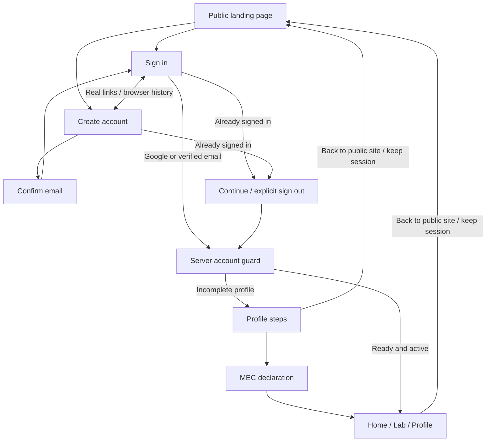

# Retro auth experience and navigation — 2 November 2026

Owner direction: merge the landing page's bright neo-brutalism, cinematic ASCII
intro and supplied retro-game/dithered-auth references. Keep login/signup compact,
reduce text, provide imagery/graphics, motion and loading feedback. Preserve real
Google/email flows and server-side account/onboarding boundaries.

## Visual implementation

The public auth cards use the established yellow/pink palette, hard borders and
shadows, self-hosted Anton/Bricolage/Press Start typography, original code-built
ASCII sphere in a terminal/game window, pixel edging and original starbursts.
Existing published Ultimaker and Raspberry Pi workshop images appear as small
monochrome lab/event cards. No new stock asset, external animation SDK, video,
font request or fake testimonial was introduced. Artwork is decorative with
aria-hidden and empty image alternatives; labels and instructions remain HTML.

The 57×29 ASCII canvas paints at about 12 frames/second for at most 4.2 seconds,
caps device pixel ratio at two and stops for reduced-motion changes or a hidden
tab. Observers/listeners/frames are cleaned up on unmount; a static code-art
fallback remains in the document. CSS entrances/hover and card transitions are
bounded, with reduced-motion alternatives. No 10-second boot animation delays
access to these forms.

## User flow and wireframe

Forms retain visible email/password labels, password-manager/paste support,
password visibility, provider pending feedback, generic provider errors,
confirmation and recovery links. Signed-in auth entry renders a server-verified
continuation card instead of replacement login/signup forms. Intentional logout
uses the existing expected_account-bound POST action. The homepage link preserves
the session. /app and account-access keep proxy/session and profile/admission
checks, so Back/Forward cannot grant membership or bypass onboarding.

Login/signup now use actual Next links instead of manual pushState. This clears
view-specific notices and supports modifier-click, browser history and no-JavaScript
navigation. Heading focus is restored after route transitions.

A matching grid/card skeleton appears during client link navigation. Route-level
loading.tsx files were deliberately removed after a real no-JavaScript browser
check showed streamed forms remained hidden behind their fallback. Direct/no-JS
visits now receive the complete server-rendered form. The navigation skeleton does
not create a second main landmark and is replaced when the destination arrives.

## Session protection changes

The pure inspectAuthEntry helper projects only authoritative getUser results.
Active identity redirects stale login/signup/callback/cleanup attempts to fixed
/app; uncertain/network identity checks fail closed. This preserves an account
from those stale per-request actions. It is not an atomic cross-tab or concurrent
HTTP-response lock; that broader race is not claimed resolved. Existing PKCE
confirmation cleanup and fixed/canonical redirect destinations remain.

## Actual local verification

- Lint, TypeScript, optimized acceptance build and 159 boundary tests pass.
- Real configured development browser: both routes, light/dark, six viewports
  from 320×568 through 1440×900 fit without ordinary scrolling or horizontal
  overflow. Axe WCAG 2.2 AA snapshots at 390px and 1366px report zero violations.
- Final current-source 48-case disabled-production/configured-development matrix
  passes with motion enabled: both routes, both themes and six viewport sizes.
  Eight axe snapshots pass. Source-bound [local evidence](../research/retro-auth-local-2026-11-02.json)
  records the tested files and exact source hashes. Whole-site production Chromium acceptance now passes.
- Actual animation sampling confirms moving canvas frames, stable frames after
  completion, stable reduced-motion output and no forever animation.
- Held real page navigation shows the skeleton and its replacement. This uses a
  delayed page response, not a substituted auth/provider service.
- Real JS-enabled and JS-disabled signup/sign-in/Back navigation pass; old invalid
  notices disappear on the other route. Anonymous workspace access redirects.
- Enlarging text to 200% keeps the form within the viewport width and allows
  vertical scrolling for accessibility. Extremely short windows/virtual keyboards
  may also scroll; no content is clipped by overflow locks.
- Independent source review found no new auth authority/permission regression;
  scoped motion findings were fixed. Real signed-in continuation, cross-client
  provider/onboarding and live account-switch acceptance remain unverified here.

No credentials, account field values or sessions were recorded. No database,
provider settings or storage policies changed. Work is local/unpushed/undeployed.

## Ownership and acceptance ledger

| Owner | Dependency | State | Evidence / next action |
| --- | --- | --- | --- |
| Main | Owner references and UI UX Pro Max guidance | Implemented locally | Original console/code art, published lab/event assets, compact retro forms |
| Scoped auth worker + main | Existing identity and route contracts | Implemented; 7 new regressions pass | Active-account guards and fixed continuation; cross-request atomicity not claimed |
| Independent reviewer | Current visual/auth source | Reviewed | No new authority regression; finite motion and scoped styles verified |
| Main browser QA | Current development server | Passed scoped checks | 48 configured/disabled theme/size cases, 8 axe snapshots, motion/skeleton/Back/no-JS/200% text |
| Main production QA | Optimized current-source build | Passed | Actual public/configuration journey, light/dark/layout/axe, loader, motion, previews/drafts/security/PWA; genuine account journeys excluded |
| Owner + main | Genuine Google session and protected onboarding | Unverified for this source | Private sign-in, Back, continuation/switch and onboarding acceptance before push/release |

Observed failures were corrected rather than excluded: the initial poster layout
overflowed in the disabled state; a whole-panel opacity entrance briefly reduced
contrast; theme color interpolation briefly reduced link contrast; and whole-grid
transforms caused transient mobile scrollbars despite a fitting settled layout.
Final cards remain readable/anchored while the decorative artwork moves. Compact
signup uses shorter switch copy; notice artwork scales down rather than overlapping
feedback. None of the original no-scroll or axe assertions was weakened.

Final whole-site acceptance completed successfully on the final optimized build.
It covers the public journey, five responsive widths in both themes, login/signup
and recovery layouts, palette/axe checks, no-JavaScript content, loader/motion,
keyboard focus, previews and drafts, security headers, PWA/offline boundaries.
This is not real account/provider/onboarding acceptance. No required check was
silenced, lowered or replaced with a fake provider. Source hashes in the linked
evidence record match the final tested application files.
